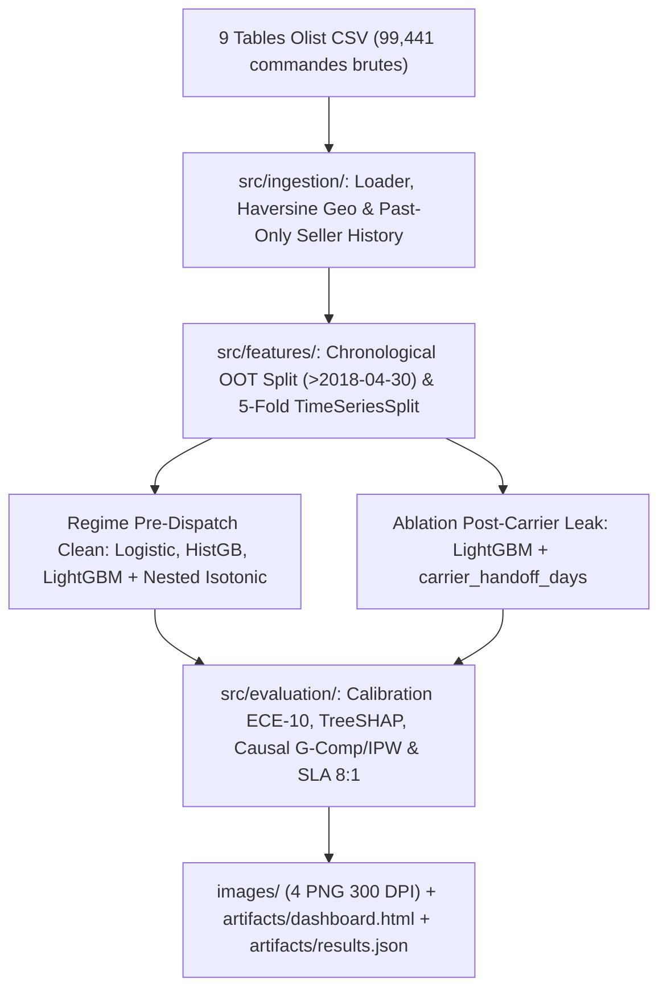
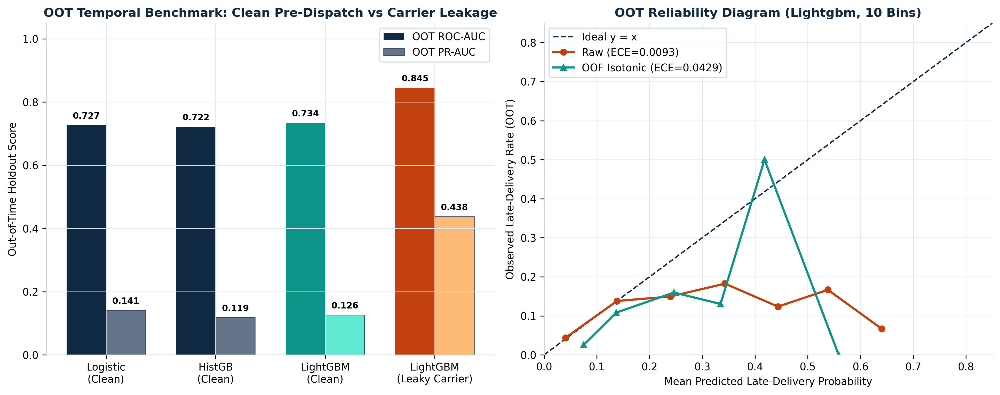
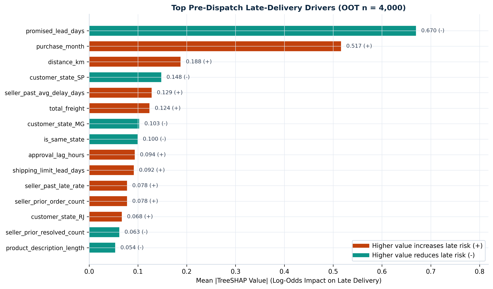
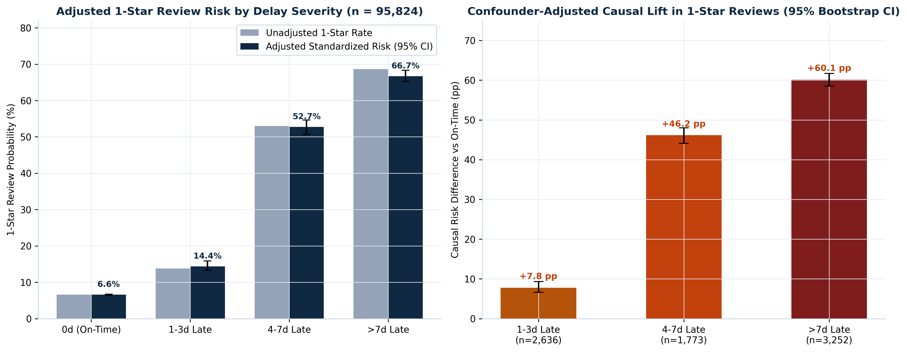
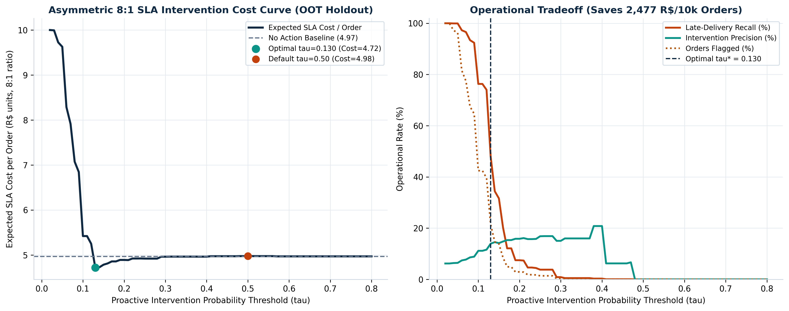

<div align="center">

# SCLDO — Supply Chain Late-Delivery & SLA Risk Intelligence
### Étude Logistique sur 96 470 Commandes E-Commerce (Olist Brésil, 9 Tables), Validation Temporelle Stricte, Économétrie Causale des Avis 1 Étoile & Politique SLA Asymétrique 8:1

<br/>


-B45309?style=flat-square)


<br/>

**"From Data to Systems"**  
Monographie de Data Science logistique analysant **96 470 commandes livrées** (9 tables relationnelles Olist, taux de retard global `8.11 %`), combinant ingénierie géospatiale Haversine sans fuite temporelle, validation chronologique hors-temps (*5-fold expanding CV* + *OOT holdout* `> 2018-04-30`), ablation quantitative de la fuite post-transporteur (`+0.1110` AUC illusoire), économétrie causale du retard sur les avis 1 étoile (`95 824` avis, IC bootstrap 95 %) et optimisation d'une politique d'intervention SLA proactive sous coût asymétrique `8:1`.

</div>

<br/>

<table align="center">
<tr>
<td align="center"><h2>96,470</h2><sub>commandes livrées (9 tables Olist)</sub></td>
<td align="center"><h2>8.11%</h2><sub>taux de retard (7 826 commandes)</sub></td>
<td align="center"><h2>0.7346</h2><sub>OOT ROC-AUC pré-expédition (LightGBM)</sub></td>
<td align="center"><h2>+0.1110</h2><sub>biais AUC par fuite transporteur</sub></td>
<td align="center"><h2>+60.1 pp</h2><sub>hausse causale d'avis 1★ (&gt;7j retard)</sub></td>
<td align="center"><h2>2,477 R$</h2><sub>économie SLA / 10k commandes (τ* = 0.13)</sub></td>
</tr>
</table>

---

## Table des Matières

1. [Problématique Logistique & Enjeux SLA](#problématique-logistique--enjeux-sla)
2. [Ingestion Relationnelle (9 Tables Olist) & Intégrité Zéro Fuite](#ingestion-relationnelle-9-tables-olist--intégrité-zéro-fuite)
3. [Architecture du Système](#architecture-du-système)
4. [Méthodologie : Validation Temporelle, Ablation Transporteur & Économétrie Causale](#méthodologie--validation-temporelle-ablation-transporteur--économétrie-causale)
5. [Résultats Empiriques, Impact Causal & Politique SLA 8:1](#résultats-empiriques-impact-causal--politique-sla-81)
6. [Preuves Visuelles (300 DPI)](#preuves-visuelles-300-dpi)
7. [Dictionnaire des Variables & Hyperparamètres](#dictionnaire-des-variables--hyperparamètres)
8. [Dashboard Interactif & Guide de Reproduction](#dashboard-interactif--guide-de-reproduction)

---

## Problématique Logistique & Enjeux SLA

Les pipelines de prédiction de retard de livraison sur données e-commerce (Olist) échouent fréquemment en production pour trois raisons majeures :
1. **Fuite temporelle et post-expédition** : de nombreux notebooks incluent `order_delivered_carrier_date` (disponible seulement après remise au transporteur) ou calculent des taux de retard vendeur globaux sur l'ensemble du dataset. Cela gonfle artificiellement l'AUC vers `0.85` tout en rendant le modèle inexploitable à la confirmation de commande.
2. **Non-stationnarité opérationnelle** : le taux de retard évolue fortement dans le temps (`8.79 %` sur l'historique d'entraînement jusqu'au `2018-04-30` avec un pic à `16.10 %` au pli 4, contre `6.21 %` sur le holdout OOT `> 2018-04-30`), ce qui affecte la calibration probabiliste hors-temps.
3. **Découplage entre score prédictif et coût client** : un seuil par défaut à `0.50` ne déclenche aucune intervention utile (`Recall = 0.00 %`), alors qu'un retard supérieur à 3 jours provoque une falaise brutale dans les avis 1 étoile (`14.37 %` à `1-3j` → `52.74 %` à `4-7j`).

---

## Ingestion Relationnelle (9 Tables Olist) & Intégrité Zéro Fuite

Les modules [`src/ingestion/olist_loader.py`](./src/ingestion/olist_loader.py), [`geospatial_builder.py`](./src/ingestion/geospatial_builder.py), [`seller_history_builder.py`](./src/ingestion/seller_history_builder.py) et [`order_dataset_builder.py`](./src/ingestion/order_dataset_builder.py) assemblent les **9 fichiers CSV Olist** :
- **Périmètre validé** : `99 441` commandes brutes → `96 478` livrées → `96 470` commandes avec dates `order_delivered_customer_date` et `order_estimated_delivery_date` valides (`95 824` commandes évaluées par avis client, `2 959` vendeurs uniques, `27` États brésiliens).
- **Cible binaire** : `is_late = (order_delivered_customer_date > order_estimated_delivery_date)` (`7 826` retards, `8.11 %`).
- **Géospatial Haversine** : déduplication médiane bornée au territoire brésilien (`19 010` préfixes postaux valides, couverture de distance `99.51 %`) et indicateur inter-États (`is_same_state`).
- **Historique vendeur strictement causal** : `seller_past_late_rate` et `seller_past_avg_delay_days` n'agrègent que les commandes antérieures **déjà livrées avant** `order_purchase_timestamp` (`effective_resolved_ns < purch_ns` via `np.searchsorted(..., side="left")`) avec lissage bayésien (`m = 10`, prior `0.08`), excluant toute commande future ou en cours d'acheminement.

---

## Architecture du Système

Choix technique justifié avant implémentation : **Python 3.10 + LightGBM / scikit-learn + TreeSHAP + IRLS/IPW NumPy + Matplotlib/Plotly** offrent le meilleur compromis reproductibilité, précision tabulaire sur données mixtes et auditabilité statistique (zéro dépendance superflue, DAG strictement unidirectionnel conforme à [`ELMAS.md`](./ELMAS.md)).



---

## Méthodologie : Validation Temporelle, Ablation Transporteur & Économétrie Causale

1. **Séparation chronologique stricte (`temporal_splitter.py`)** : entraînement sur `2016-09-15` → `2018-04-30` (`71 118` commandes, `8.79 %` de retard) et test hors-temps (OOT) sur `2018-05-01` → `2018-08-29` (`25 352` commandes, `6.21 %` de retard), complétés par une validation croisée temporelle glissante à `5` plis (`TimeSeriesSplit`) avec calibration isotonique imbriquée sur `3` plis internes.
2. **Ablation de fuite post-transporteur (`benchmark_runner.py`)** : comparaison directe entre le régime propre pré-expédition (`31` variables disponibles à la confirmation de commande) et le régime contaminé ajoutant `carrier_handoff_days`, `carrier_delay_vs_limit_days` et `remaining_promised_days_after_carrier`.
3. **Économétrie causale (`causal_review_impact.py`)** : estimation de la probabilité ajustée d'avis 1 étoile par tranche de retard (`0j`, `1-3j`, `4-7j`, `>7j`) via standardisation G-computation (régression logistique ridge IRLS contrôlant prix logarithmique, ratio fret, distance Haversine, délai promis, nombre d'articles, même État, top États, top catégories et trimestre) avec **120 réplications bootstrap (IC 95 %)** et contre-vérification par pondération inverse de propension stabilisée (**IPW**).
4. **Optimisation SLA asymétrique `8:1` (`sla_policy_optimizer.py`)** : arbitrage entre le coût d'une intervention proactive (`10 R$`, notification + bon de rétention / escalade) et la perte liée à un retard non mitigé (`80 R$`, churn + avis 1 étoile), donnant un seuil théorique de Bayes à $\tau_{\text{Bayes}} = 10 / 80 = 0.125$.

---

## Résultats Empiriques, Impact Causal & Politique SLA 8:1

### 1. Benchmark Temporel & Ablation de Fuite Post-Transporteur

| Régime / Modèle | Calibration | CV ROC-AUC | CV ECE-10 | OOT ROC-AUC | OOT PR-AUC | OOT Brier | OOT ECE-10 |
|---|---|---:|---:|---:|---:|---:|---:|
| **Pre-Dispatch Clean — Logistic Reg.** | Raw | `0.6763` | `0.0375` | `0.7289` | **`0.1466`** | **`0.0568`** | `0.0144` |
| **Pre-Dispatch Clean — Logistic Reg.** | OOF Isotonic | `0.6587` | `0.0287` | `0.7269` | `0.1409` | `0.0599` | `0.0525` |
| **Pre-Dispatch Clean — HistGB** | Raw | `0.6701` | `0.0328` | `0.7238` | `0.1235` | `0.0575` | `0.0099` |
| **Pre-Dispatch Clean — HistGB** | OOF Isotonic | `0.6435` | `0.0337` | `0.7220` | `0.1188` | `0.0575` | `0.0304` |
| **Pre-Dispatch Clean — LightGBM** | Raw | **`0.6881`** | `0.0421` | **`0.7346`** | `0.1291` | `0.0574` | **`0.0093`** |
| **Pre-Dispatch Clean — LightGBM** | OOF Isotonic | `0.6588` | **`0.0259`** | `0.7341` | `0.1262` | `0.0582` | `0.0429` |
| **Post-Carrier Leaky — LightGBM** *(ablation)* | Raw | `0.7528` | `0.0402` | `0.8456` | `0.4528` | `0.0441` | `0.0115` |
| **Post-Carrier Leaky — LightGBM** *(ablation)* | OOF Isotonic | `0.7273` | `0.0250` | `0.8451` | `0.4376` | `0.0469` | `0.0516` |

> **Enseignement critique sur la calibration hors-temps** : en validation croisée intra-période (`CV`), la calibration isotonique réduit l'ECE-10 de `LightGBM` de `0.0421` à `0.0259` (`-38.5 %`). En revanche, sur le holdout OOT où la prévalence chute de `8.79 %` à `6.21 %`, le calibrateur isotonique ajusté sur l'historique surestime mécaniquement le risque (`ECE-10 = 0.0429` vs `0.0093` brut) — illustrant l'importance d'une recalibration glissante en contexte non-stationnaire. Par ailleurs, l'inclusion de la date de remise au transporteur gonfle artificiellement l'AUC OOT de **`+0.1110`** et triple presque le PR-AUC (`0.1262` → `0.4376`).

### 2. Impact Causal du Retard sur les Avis 1 Étoile (`n = 95 824`)

| Tranche de Retard | Commandes | Note Moy. | Avis 1★ Brut | Risque Ajusté (G-Comp) | IC Bootstrap 95 % | Lift Causal vs À l'Heure | Contre-vérif. IPW |
|---|---:|---:|---:|---:|---:|---:|---:|
| **0d (On-Time)** | `88 163` | `4.29` | `6.58%` | **`6.59%`** | `[6.43%, 6.74%]` | `0.00 pp` | `6.57%` |
| **1-3d Late** | `2 636` | `3.77` | `13.77%` | **`14.37%`** | `[13.31%, 15.88%]` | **`+7.78 pp`** `[+6.63, +9.32]` | `16.66%` |
| **4-7d Late** | `1 773` | `2.32` | `53.02%` | **`52.74%`** | `[50.75%, 54.63%]` | **`+46.15 pp`** `[+44.11, +47.98]` | `52.07%` |
| **>7d Late** | `3 252` | `1.73` | `68.63%` | **`66.72%`** | `[65.18%, 68.35%]` | **`+60.13 pp`** `[+58.54, +61.70]` | `63.71%` |

### 3. Politique d'Intervention SLA Proactive (Ratio `8:1`, OOT Holdout)

| Politique SLA | Seuil $\tau$ | Recall Retard | Précision | Commandes Ciblées | Coût / Commande | Coût / 10k Cmd | Économie / 10k Cmd |
|---|---:|---:|---:|---:|---:|---:|---:|
| **Aucune action (Baseline)** | — | `0.00%` | — | `0.00%` | `4.9700 R$` | `49 700 R$` | `0 R$` |
| **Seuil par défaut** | `0.500` | `0.00%` | `0.00%` | `0.06%` | `4.9755 R$` | `49 755 R$` | `-55 R$` |
| **Seuil Bayes théorique (10/80)** | `0.125` | `63.56%` | `12.60%` | `31.34%` | `4.9456 R$` | `49 456 R$` | `+245 R$` |
| **Seuil Optimal Empirique** | **`0.130`** | **`48.00%`** | **`13.95%`** | **`21.38%`** | **`4.7223 R$`** | **`47 223 R$`** | **`+2 477 R$`** |

---

## Preuves Visuelles (300 DPI)

| Figure | Analyse |
|---|---|
|  | **Benchmark Temporel & Fuite Transporteur.** Comparaison OOT entre modèles pré-expédition propres (`LightGBM = 0.734`) et ablation post-transporteur (`0.845`), accompagnée des courbes de fiabilité 10-bins. |
|  | **Attribution TreeSHAP Pré-Expédition (`n = 4 000`).** Domination du délai promis (`0.670 -`), de la saisonnalité (`0.517 +`), de la distance Haversine (`0.188 +`), de l'État `SP` (`0.148 -`) et de l'historique vendeur passé (`0.129 +`). |
|  | **Impact Causal du Retard sur les Avis 1 Étoile.** Falaise non-linéaire entre `1-3j` (`+7.8 pp`) et `4-7j` (`+46.2 pp`) jusqu'à `+60.1 pp` au-delà de 7 jours (IC bootstrap 95 %). |
|  | **Économie de la Politique SLA `8:1`.** Courbe de coût attendu par seuil $\tau$ : l'optimum $\tau^* = 0.130$ capte `48.0 %` des retards en ciblant `21.4 %` des expéditions et économise `2 477 R$` / `10 000` commandes. |

---

## Dictionnaire des Variables & Hyperparamètres

- **Variables pré-expédition propres (`31`)** : `promised_lead_days`, `shipping_limit_lead_days`, `approval_lag_hours`, `distance_km`, `is_same_state`, `item_count`, `unique_product_count`, `unique_seller_count`, `total_price`, `total_freight`, `freight_ratio`, `payment_value_sum`, `max_installments`, `payment_count`, `product_weight_g`, `product_volume_cm3`, `product_photos_qty`, `product_description_length`, `purchase_month`, `purchase_dayofweek`, `purchase_hour`, `is_weekend_purchase`, `is_q4_peak`, `seller_prior_order_count`, `seller_prior_resolved_count`, `seller_past_late_rate`, `seller_past_avg_delay_days`, `customer_state`, `seller_state`, `product_category_english`, `primary_payment_type`.
- **Variables post-transporteur ségréguées (ablation uniquement)** : `carrier_handoff_days`, `carrier_delay_vs_limit_days`, `remaining_promised_days_after_carrier`.
- **Hyperparamètres** : `LightGBM` (`n_estimators=320`, `learning_rate=0.04`, `num_leaves=48`, `min_child_samples=40`, `subsample=0.85`, `colsample_bytree=0.85`), `HistGradientBoosting` (`max_iter=240`, `learning_rate=0.05`, `max_leaf_nodes=48`), `LogisticRegression` (`C=1.0`, `max_iter=500`).

---

## Dashboard Interactif & Guide de Reproduction

- **Dashboard Plotly HTML5 autonome** : [`artifacts/dashboard.html`](./artifacts/dashboard.html)
- **Sortie JSON complète vérifiée** : [`artifacts/results.json`](./artifacts/results.json)
- **Notebook de référence** : [`notebooks/scldo_supply_chain_study.ipynb`](./notebooks/scldo_supply_chain_study.ipynb)
- **Suite de tests (`12/12` passés, incluant audit AST `ELMAS.md`, non-fuite temporelle et invariants causaux)** :

```powershell
.\run.ps1
C:\Users\elmas\AppData\Local\Programs\Python\Python310\python.exe -m pytest -v
```
